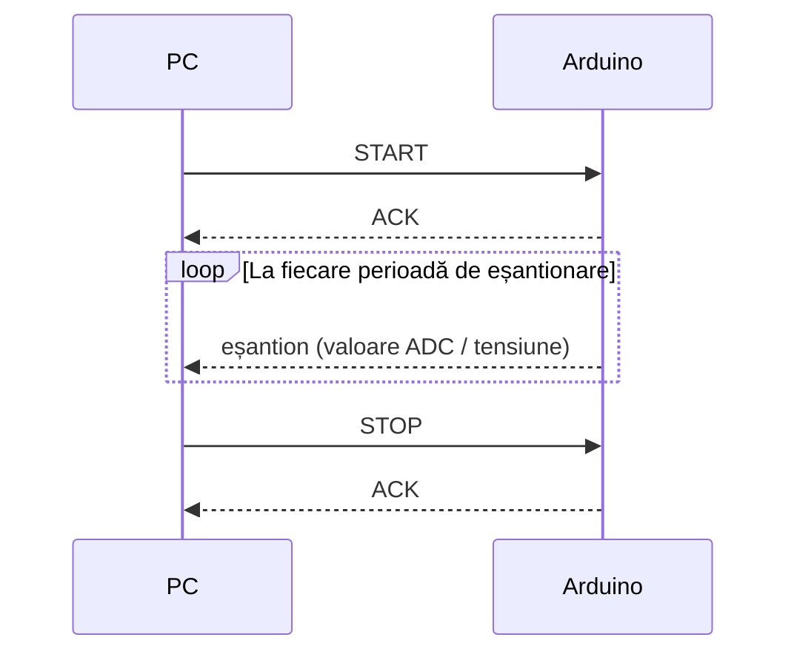
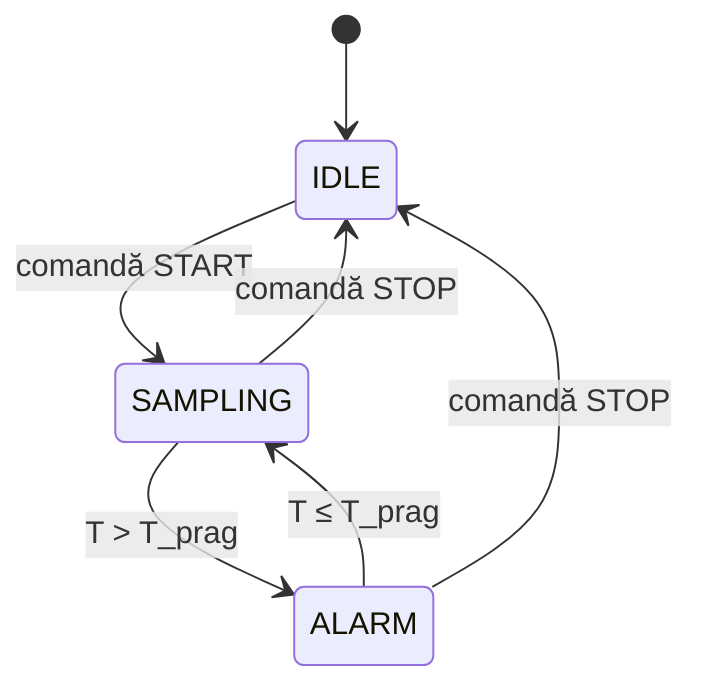

# Protocol de comunicație PC – Arduino

## Schimbul de mesaje

După comanda `START`, Arduino confirmă cu `ACK` și începe să trimită eșantioane la fiecare perioadă de eșantionare, până primește `STOP`.

## Comenzi suportate

| Comandă  | Cod    | Efect                                                      |
|----------|--------|------------------------------------------------------------|
| `START`  | `0x01` | Pornește achiziția; Arduino răspunde `ACK` și trimite eșantioane |
| `STOP`   | `0x02` | Oprește achiziția și revine în starea de repaus            |
| `STATUS` | `0x03` | Returnează starea curentă a automatului (IDLE/SAMPLING/ALARM) |

## Automatul de achiziție

- **IDLE**: repaus, nu se eșantionează.
- **SAMPLING**: eșantionare activă la perioada configurată.
- **ALARM**: temperatura a depășit pragul; revine în SAMPLING când scade sub prag.