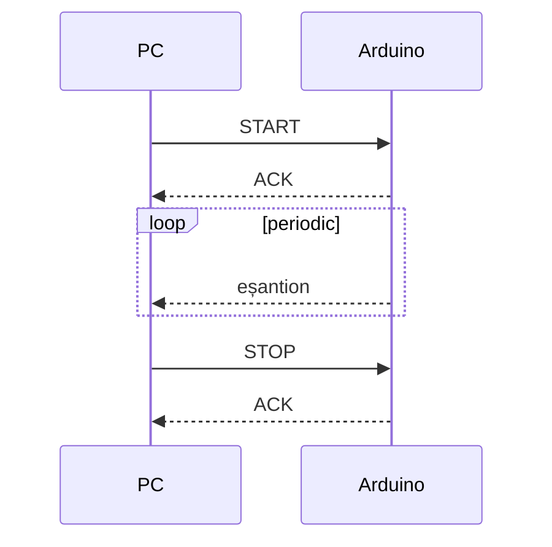

# Protocol de comunicație PC – Arduino

Acest document descrie protocolul serial dintre PC și Arduino: schimbul de mesaje și comenzile suportate.

Parametri legăturii seriale: 115200 baud, 8N1. Comenzile și răspunsurile sunt șiruri ASCII terminate cu `\n`.

## Schimbul de mesaje

PC-ul trimite comanda `START`. Arduino confirmă cu `ACK` și începe să trimită eșantioane la fiecare perioadă de eșantionare, până când primește `STOP`.

## Comenzi suportate

| Comandă  | Cod    | Efect                                                            |
|----------|--------|------------------------------------------------------------------|
| `START`  | `0x01` | Pornește achiziția; Arduino răspunde `ACK` și trimite eșantioane |
| `STOP`   | `0x02` | Oprește achiziția; Arduino răspunde `ACK`                        |
| `STATUS` | `0x03` | Arduino răspunde cu starea curentă a achiziției                  |